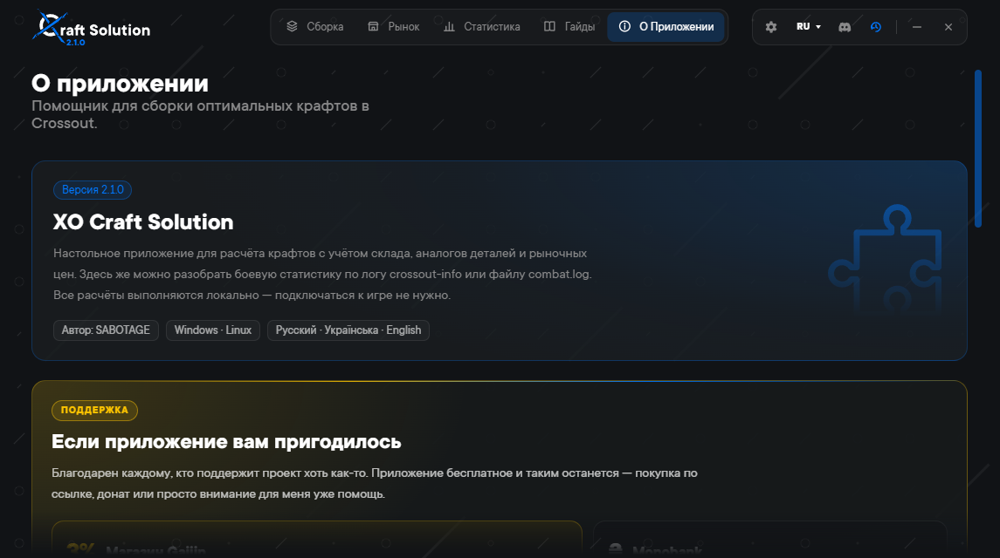
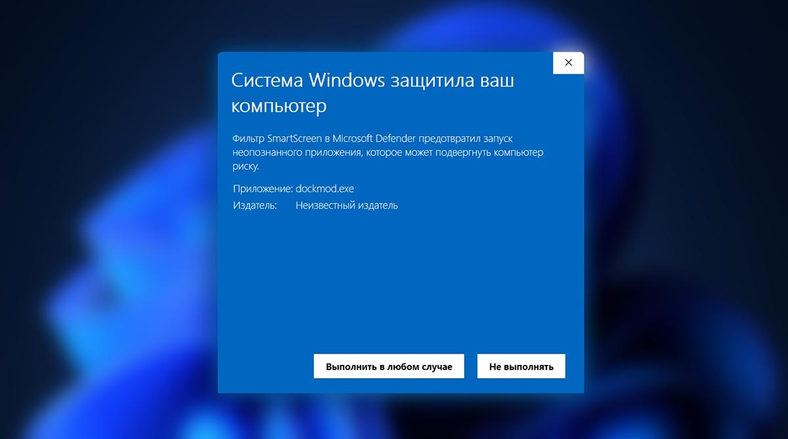
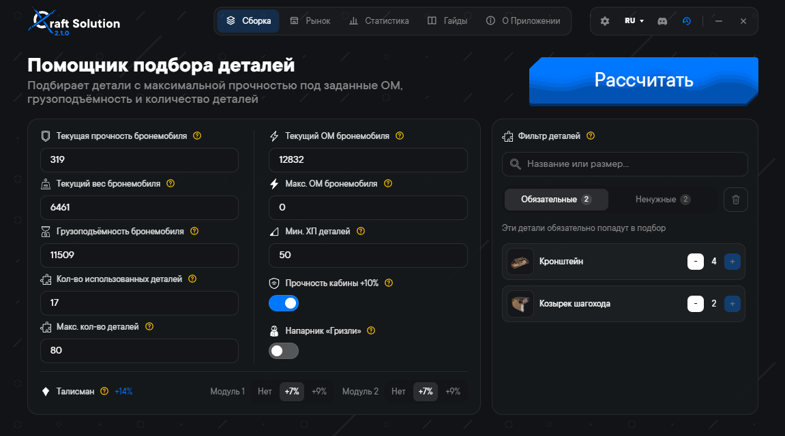
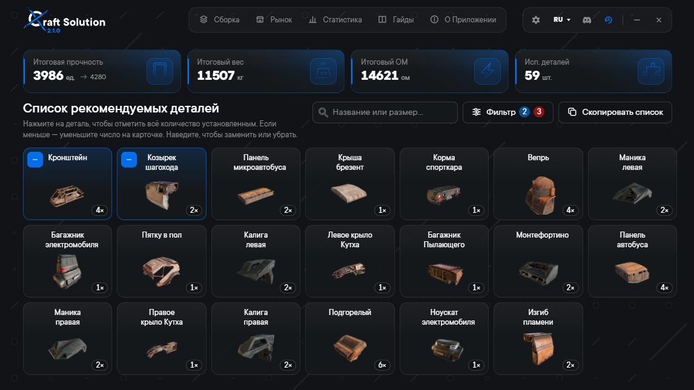
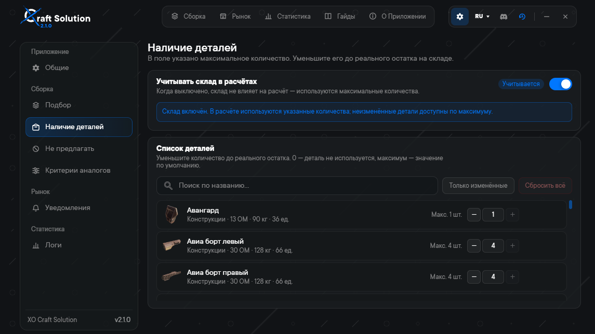
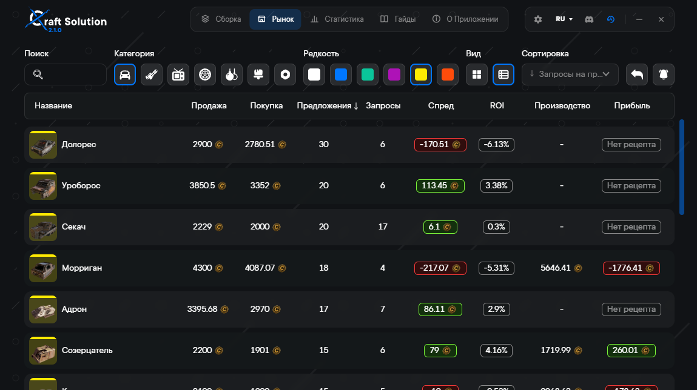
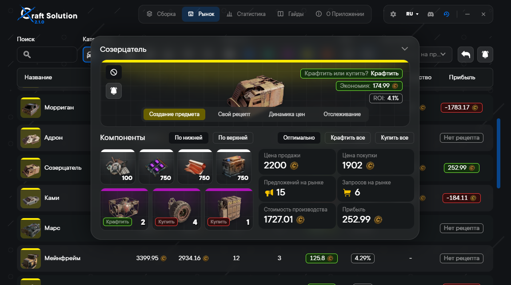
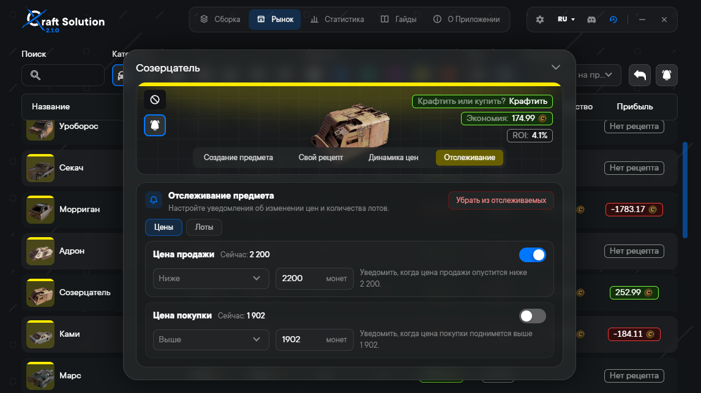
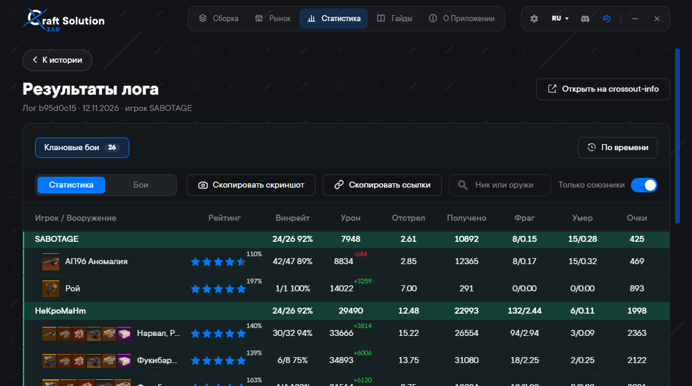

# XO Craft Solution

Настольное приложение для Crossout: подбор брони, склад, рынок и разбор боёв в одном месте.

Автор — [SABOTAGE](https://github.com/nanosabo). Интерфейс на русском, украинском и английском.

## Как скачать

Актуальная сборка всегда лежит на странице последнего релиза:

**[Скачать XO Craft Solution](https://github.com/nanosabo/XO-Craft-Solution/releases/latest)**

| Система | Какой файл брать |
| --- | --- |
| Windows 10 и новее, 64-bit | установщик `XO-Craft-Solution-…-Setup.exe` |
| Linux, 64-bit | `XO-Craft-Solution-Linux-….AppImage` |

На Windows установщик спрашивает папку. При удалении настройки, склад и история остаются на диске.

При первом запуске Windows может написать, что защитила компьютер, и не показать кнопку установки сразу. Так система встречает любую программу без платного сертификата подписи. Сертификат стоит денег, у проекта его нет, поэтому издатель для Windows неизвестен. Это окно проверки подписи, а не сообщение о вирусе. Файл берите только со страницы релиза выше. В окне нажмите «Подробнее», затем «Выполнить в любом случае».

На Linux сделайте AppImage исполняемым и запустите его. Если система отказывается открывать файл, чаще всего не хватает FUSE: пакет `fuse` или `libfuse2`.

Установленная версия сама проверяет обновления на GitHub при запуске. Проверку можно выключить и запустить вручную в настройках. Загрузка идёт в фоне, поставить обновление можно сразу или при следующем запуске.

## Возможности

### Сборка

Приложение ищет броню с максимальной прочностью, которая помещается в оставшиеся грузоподъёмность, потолок очков мощи и лимит деталей. Цифры снимаются с уже собранной машины: рама, оружие, ходовая и модули стоят, расчёт добавляет броню к ним.

Учитываются бонус кабины +10%, напарник «Гризли» и до двух талисманов: обычный даёт +7% к прочности кабины, улучшенный +9%. Минимальная прочность детали отсекает слишком хрупкие позиции. Потолок ОМ можно не задавать.

В фильтре одни детали помечаются как обязательные, другие исключаются из подбора. Если в настройках включён склад, расчёт не предложит больше, чем есть в наличии.

На экране результата видно итоговые массу, ОМ, прочность и число деталей. По строке можно отметить, сколько уже поставлено на машину, заменить деталь похожей или убрать её из выборки. «Больше не предлагать» скрывает деталь и из следующих расчётов: решение можно вернуть, пока не истекло время отмены. Отдельно показывается, что с машины стоит снять.

Синяя кнопка с часами в шапке открывает последнее решение и не запускает подбор заново.

### Склад и скрытые детали

В настройках сборки у каждой детали задаётся реальное количество на складе. Ноль означает, что деталь не используется. Учёт склада выключается одним тумблером: количества сохраняются, но в расчёт не попадают.

Отдельный список «Не предлагать» убирает детали, которые почти всегда оказываются неудобными. Например, «Горбатый» или «Хвост багги». Список остаётся на месте, а тумблер «Учитывать при всех расчётах» возвращает его целиком и так же быстро выключает обратно.

### Аналоги

Замена подбирается в той же категории. В настройках задаются допуски по очкам мощи, массе и прочности. На карточке результата вкладка «Похожие» показывает такие аналоги и детали того же размера: стороны можно переставить местами, количество в решении сохраняется.

### Рынок

Список рынка строится по публичным ценам и лотам. Видны цена продажи и покупки, число предложений и запросов, спред и ROI с учётом комиссии, себестоимость крафта и прибыль от производства. Список фильтруется по названию, категории и редкости, переключается между карточками и таблицей и сортируется по цене, лотам, выгоде перепродажи, выгоде крафта и ROI.

Карточка детали отвечает, что выгоднее: крафтить или купить. В ней официальный рецепт, график цен и лотов и свой рецепт на этот компьютер: он нужен, когда акция меняет набор ингредиентов, количество на выходе или плату за станок. Свой рецепт никуда не отправляется.

### Отслеживание

У детали задаётся правило на цену продажи, цену покупки или число лотов: любое изменение, ниже, ниже или равно, выше, выше или равно. Сигнал выбирается в настройках: звон монет, радар, мягкий сигнал или свой файл. Уведомления приходят и при свёрнутом окне.

### Боевая статистика

Открывается файл `combat.log` или уже готовая ссылка на лог [crossout-info](https://crossout-info.com). Если в настройках указана папка логов Crossout, приложение само находит самый новый файл. Прошлые загрузки хранятся в истории на этом компьютере.

В логе — типы боёв, карты, игроки, оружие, урон, фраги, винрейт и очки. Таблицу можно сузить по времени, нику, оружию, карте и только союзникам, скопировать ссылку или снимок таблицы. Ссылку на лог можно вставить сочетанием Ctrl+V прямо на странице статистики.

Запись боя в игре включается параметром запуска `--cvar cl_combatLog 1`. Файл появляется после боя, доигранного до экрана победы или поражения, в папке `AppData/Local/Targem/Crossout/logs`.

### Всё остальное в приложении

- Гайды по экранам сборки, рынка и статистики: что вводить и что откроется дальше.
- Стартовый экран: сборка, рынок или статистика.
- Запуск вместе с системой и сворачивание в трей.
- Проверка обновлений с GitHub.
- Кэш фильтров и последнее решение сбрасываются отдельно от склада и настроек.

## Данные

Настройки, склад, скрытые детали, свои рецепты и история логов лежат только на этом компьютере. Цены и лоты берутся из публичных данных [crossoutcore.ru](https://crossoutcore.ru). Боевая статистика — из `combat.log` и [crossout-info.com](https://crossout-info.com).

## Обратная связь

Баг или идея — в [GitHub Issues](https://github.com/nanosabo/XO-Craft-Solution/issues) или в [Discord](https://discord.gg/cwtHShAfZx). Напишите, что произошло и что вы ожидали увидеть.

## Поддержка

Приложение бесплатное и таким останется.

- [Магазин Gaijin](https://store.gaijin.net/catalog.php?category=Crossout&partner=SABOTAGE&partner_val=rwdcmjgd) — скидка 3% на каталог Crossout и наклейка SABOTAGE. Покупка по этой ссылке поддерживает автора.
- [Банка Monobank](https://send.monobank.ua/jar/4CErJGG8WM) — если удобнее поддержать разработку напрямую.

Рынок и статистика держатся на чужих проектах. Если они тоже помогают, их можно поддержать отдельно: [crossoutcore.ru](https://crossoutcore.ru) и [crossout-info.com](https://crossout-info.com).
